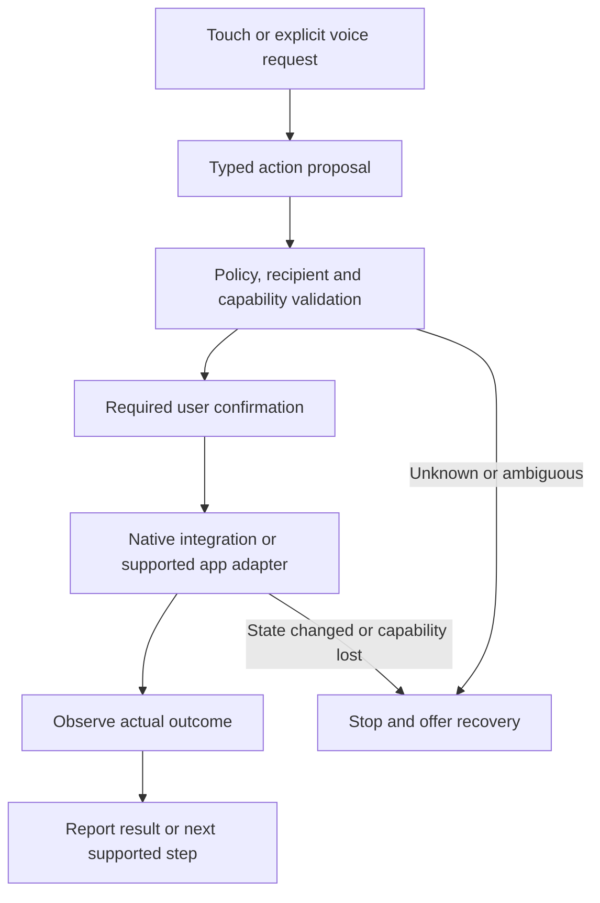

# Maa: complete accessible launcher and guided assistant

Plan date: 2026-10-03 (UTC). Status: independently reviewed and revised; ready to start the gated implementation contracts. This is a rebuild plan, not a claim that these features exist today.

## Product contract

Maa will be a dependable Android Home app with the complete relevant feature set of the BIG Launcher product family, an original accessible design, Hindi and English, and family photographs as primary navigation. The extension is an optional floating assistant and carefully tested guidance inside supported third-party apps.

Pressing normal Home navigation should return to Maa's primary screen after the owner selects Maa as the default launcher. Core Home, family selection, calling entry points, and recovery must remain usable without AI or internet. Setup and configuration belong in a protected caregiver area, with the adult owner's consent and an understandable recovery path.

“Every BIG feature” is a tracked delivery requirement, not a description of the current prototype. The reference scope includes BIG Launcher, BIG Phone, BIG SMS, BIG Notifications, and BIG Alarm, including paid functionality. The provisional inventory has 251 unique requirement records, maps all 132 documented manual preference rows, and marks 54 records for additional reference/platform gates. These counts include integration and commercial-boundary records; they do not mean that BIG has exactly 251 features. Commercial trial limits, branding, source code, and proprietary artwork are not features to reproduce. Every researched capability needs a stable ID, reference evidence, a Maa behavior, and an acceptance test. Missing or platform-blocked items remain visible; any substitution or scope reduction requires an explicit product decision.

Planning assumption: **private pilot on the Poco first, followed by a separately qualified public release**. The user has been asked about distribution; this sequence can change. There is no estimate for complete delivery until reference coverage and the risky Android integrations have been measured.

## Evidence and present state

| Evidence | Consequence |
| --- | --- |
| [Independent code audit](research/INDEPENDENT_CODE_AUDIT.md) | The prototype needs architectural changes, not cosmetic polish. |
| [BIG parity inventory](research/BIG_LAUNCHER_PARITY.md) | Full scope includes multiple companion products and detailed preferences; reference-version validation remains necessary. |
| [Android feasibility research](research/ANDROID_GUIDED_MODE.md) | Default Home is practical; unrestricted “AI controls any app” and strict WhatsApp confinement cannot be assumed. |
| [Physical device baseline](research/DEVICE_BASELINE.md) | Poco F1, Android 10/API 29, MIUI V12. Current Home resolves to a chooser. Neither WhatsApp package is installed. |
| [Production audit](PRODUCTION_AUDIT.md) | Six narrow instrumented regressions pass on the Poco; production, camera, voice, external communication, and live guidance remain unverified. |

Existing reusable work includes localization, selected large controls, explicit request confirmation, cancellation of stale AI responses, and backend action validation. Replace the monolithic screen/action handling, unprotected configuration, fixed floating Home button, and label-based masks as the foundation for the new product. Fix the known lossy amount parser before retaining any money-request workflow: it currently turns `1,000` into `1` and `-50` into `50`.

## Boundaries that shape the architecture

### Home and device control

On API 29+, use Android's Home-role flow, verify the grant, handle repeated Home intents, and detect loss of the role. Preserve the existing API 26 minimum provisionally: API 26–28 require a tested system Home-selection route such as `Settings.ACTION_HOME_SETTINGS`, guarded for activity availability, plus actual default resolution verification. Do not call newer APIs unguarded. The launcher does not own the lock screen or all system windows, and the owner can later choose another Home app. Registration in the manifest alone is insufficient. [Android Home role](https://developer.android.com/reference/android/app/role/RoleManager), [Home selection settings](https://developer.android.com/reference/android/provider/Settings#ACTION_HOME_SETTINGS)

An ordinary launcher can simplify its own app list. It cannot enforce device-wide app restrictions. A separately provisioned device-owner edition can add package allowlisting and lock task mode, but this is an optional deployment track with separate recovery and enrollment requirements. It must never imply authorization to reset the current Poco. Allowing the WhatsApp package still permits its internal features. [Android lock task mode](https://developer.android.com/work/dpc/dedicated-devices/lock-task-mode)

### WhatsApp guidance versus enforceable family-only communication

An overlay can cover content and consume touches while its window exists. It cannot remove WhatsApp's controls or guarantee they remain inaccessible when Maa dies, a service is disabled, or another entry path opens. A transparent non-touchable overlay does not block taps. Accessibility sees only the semantics the target app exposes. [Android window behavior](https://developer.android.com/reference/android/view/WindowManager.LayoutParams), [accessibility services](https://developer.android.com/guide/topics/ui/accessibility/views/service)

The requested family-first experience is the design target: Maa owns the family list and approved actions; supported WhatsApp screens receive a simplified interaction surface. Search, status, groups, broadcast, and settings are absent from Maa's surface. **That is assistance, not proven confinement of WhatsApp.** Investigate a full controlled content overlay before investing further in scattered masks or moving holes.

Official click-to-chat links provide a useful family entry point and can prefill an unsent draft. They do not supply a consumer inbox API or contact allowlist. Do not promise a full Maa-rendered WhatsApp history or family media gallery until a supported data source has been established. [WhatsApp click to chat](https://faq.whatsapp.com/5913398998672934), [WhatsApp Business Platform](https://whatsappbusiness.com/products/business-platform/)

If “the user cannot reach anyone except family” is non-negotiable, the consumer WhatsApp route is blocked until a supported enforcement mechanism is proved. The alternative is an owned or supported communication service with server-enforced family membership, which requires family adoption. Do not silently downgrade a selected strict mode to unrestricted app launch. A managed-device edition alone does not solve contact-level restriction.

### Android versions and public distribution

On the Poco's API 29, accessibility screenshot capture is unavailable; image-based assistance requires a separately consented MediaProjection flow, or a semantic-only design. Secure content must remain excluded. Later Android overlay behavior also needs its own tests. [AccessibilityService API](https://developer.android.com/reference/android/accessibilityservice/AccessibilityService), [MediaProjection](https://developer.android.com/media/grow/media-projection)

Google Play currently limits autonomous Accessibility API action planning/execution, with an exception for verified accessibility tools serving their core disability-assistance purpose. Declaring an accessibility-tool flag is not approval. Ordinary launchers and general voice assistants do not qualify merely because disabled people can use them. Decide the truthful product purpose and review route before committing to a public autonomous assistant. Keep explicit user actions and deterministic supported workflows independently useful. A private pilot does not establish policy acceptance. Recheck the policy before submission. [Google Play Accessibility API policy](https://support.google.com/googleplay/android-developer/answer/10964491?hl=en)

## Proposed architecture

Start with clear package boundaries and a small number of modules. Choose a UI framework after a short API 29 accessibility/performance prototype; a Compose rewrite is not itself a quality gate.

| Area | Responsibility and boundary |
| --- | --- |
| Accessible UI | Home, family, phone, messages, alarms, assistant states, setup and recovery; stable typed state and no direct privileged action from rendering code. |
| Local domain and storage | Canonical family identities/numbers, app choices, layouts, preferences, drafts, migrations, protected configuration and atomic updates. Sensitive credentials excluded from ordinary backups. |
| Android integrations | Home/dialer/SMS roles, Telecom, contacts, notifications, widgets, alarms, permissions, camera and lifecycle; truthful capability status. |
| Guided-app adapters | Explicit supported package/version/screen/locale profiles, semantic selectors, state recognition, recipient verification and observable outcomes. |
| Action policy and executor | Typed allowlisted actions, capability/recipient checks, confirmations, cancellation and duplicate prevention; one validated step followed by observation. |
| Voice and optional AI | Push-to-talk, localized TTS, cancellable inference and structured proposals. Screen text and model output are untrusted input, never action authority. |
| Caregiver and diagnostics | Owner-approved setup, configuration lock/recovery, local health status, consented redacted diagnostics and update recovery. |

Use a durable operation state machine: proposed → awaiting confirmation → confirmed → dispatching → observed, with cancelled and uncertain outcomes. Bind confirmation to an immutable recipient, channel, account/SIM, content and attachment identity, plus an expiry/freshness rule. Revalidate the observed target immediately before dispatch. Persist the dispatching transition before the external effect; restart/reconnect must never replay a dispatching operation automatically. A crash after this transition may leave an action uncertain even if it was never executed. Report that uncertainty; a retry needs a new informed decision. Third-party UI cannot provide transactional exactly-once delivery.

Cancellation prevents new dispatch; it cannot undo an already dispatched call/message. Serialize cancel/dispatch decisions and explain an already-issued action truthfully. Fault-inject crashes before/after confirmation, dispatch and outcome persistence; count actual side effects in a test double, then in expressly authorized integration trials. Include rapid taps, lost acknowledgements and repeated reconnects. A completed intent launch is not proof of a sent message, delivered request, or connected call.

### Guided-app execution contract

1. Store approved people using canonical identities and international phone numbers; display names alone cannot authorize a recipient. Resolve duplicate names and changed numbers explicitly.
2. Prefer official app intents, then tested semantic accessibility actions. Blind coordinates are not an accepted production action mechanism.
3. Match the current package, supported profile, window, screen and recipient before each consequential step. Invalidate stale observations after navigation, layout changes or interruption.
4. Support individual-chat entry, draft, keyboard, approved attachment/media and call states only after each is measured. Groups, unknown recipients, menus and unsupported states stop the Maa task.
5. Present/read the exact recipient and final content before Send. Material edits invalidate confirmation. A clearly labeled call shortcut may represent an intentional call action after setup; voice-selected calls require recipient confirmation. Keep cancel and Home reachable.
6. A full content overlay must provide usable reading and action feedback using only legitimately observable content. If semantics are insufficient, that workflow remains unsupported rather than guessed.
7. Test notifications, external links, Recents, shares, rotation, multiwindow, keyboard and incoming calls as separate entry/interruption paths.
8. On unknown state, Maa must refuse further actions while it is running. Service/process death can expose the native app; document this residual limit rather than claiming that a watchdog guarantees blocking.
9. Ship support per validated profile with an update-detection and disable/revalidation path. “Any app” is a long-term adapter expansion objective, not a first-release claim.

Initial AI scope: select family, open approved apps, explain supported screens, prepare messages, and perform confirmed supported actions. Automated payment execution, credential/PIN/OTP entry, and autonomous changes to permissions are outside this first executor. Retaining a money-request feature still requires exact amount parsing and explicit review.

### Manual guidance while the assistant is idle

This is a first-class requirement: user-enabled local guidance must continue in supported apps when voice is idle, cloud sharing is disabled, or the network is unavailable. It must not wait for an AI request. Each supported profile specifies the approved visible controls, which window owns each control, allowed local observations and supported input methods. Maa-owned buttons use the same identity/action policy as voice proposals.

While the service is healthy, loss of screen identity replaces Maa's controlled surface with a readable recovery state and Home/help controls. Merely stopping the model is insufficient. Validate ordinary reading/reply/cancel/Home alongside attempted activation of hidden native controls by tap, long press, rapid/double tap, swipe and touches during transitions. Separately inspect TalkBack focus/actions, keyboard and switch input; hiding pixels is not proof those paths are blocked. Test real switch hardware before claiming support.

Acceptance is no disallowed activation or touch/focus leakage through the live controlled surface in the declared profile and test set, with legitimate tasks still accessible offline. If an input path or screen cannot meet this contract, mark that profile unsupported and offer the supported Home/communication route. Do not disable another accessibility aid to claim success. Record transition exposure separately from notification/system/alternate-entry and service-death exposure. Ordinary guidance still cannot establish continuous device-wide or contact-level confinement.

### Early platform, data and upgrade contracts

Phase 0 must produce and approve these records before dependent production work. They are implementation prerequisites, not unspecified final-release chores.

**Capability matrix:** retain API 26 provisionally, with separate API 26–28, Poco API 29, target API and current stable Android test rows. For Home, app catalog, widgets, phone/SMS, contacts, notifications, alarms/full-screen presentation, location/SOS, microphone, media/camera, overlay and accessibility, record the narrowest API/role, permission/settings prerequisites, version guards, public distribution requirements, decline/revocation fallback, background/locked/reboot behavior and exact environment. Home has the fallback above; default phone/SMS need their own version-specific role/request contracts. App visibility and full-screen/background/foreground-service restrictions need explicit current-policy checks. No dependent ticket starts with an unresolved required API. Raising minimum support is an explicit scope decision.

**Observation sessions:** manual guidance has an explicit user-enabled local session limited to supported app windows. Screen-aware AI has a separate visibly active task session and a Stop action. Accessibility access is not cloud-sharing consent. App/window changes invalidate prior context; unsupported/sensitive screens and lock stop contextual capture/upload. Task completion, cancellation and permission revocation end AI observation. Resuming requires a fresh scoped action. Local Home and manual guidance remain usable with cloud sharing off.

| Input | Processing and allowed disclosure | Retention and verification |
| --- | --- | --- |
| Family identities/photos | Local canonical policy. Send an opaque contact ID and only task-required labels if a cloud proposal needs them; resolve recipient numbers locally. | No contact-directory or photo upload by default. Explicit deletion/export rules; no contacts in diagnostics. |
| Speech/transcript | Push-to-talk only. Record whether the chosen recognizer processes locally or through its provider; disclose that route. Optional inference receives only the consented task transcript. | No background mic; no retained raw audio by default. Cancelled/stale text is not submitted. Do not claim offline speech without an offline engine test. |
| Accessibility nodes/notification text | Minimum fresh local semantics for enabled guidance or separately enabled notification features. Cloud screen context is separately opt-in for the current task. | No passive conversation archive. Do not upload entire trees or unrelated notifications; do not treat visible message instructions as authority. |
| Screenshot | Off by default. Capture only a supported task/window with platform and product consent; API 29 needs MediaProjection. | Secure/credential/OTP/payment-authentication contexts excluded. No arbitrary background screenshots; bounded transient data, cleared on stop. |
| Diagnostics/backend requests | Redacted operation IDs, versions, timing and error categories. Fix provider configuration, processing destination and any retention contract before transmission. | No routine transcript, message, photo or screenshot logging. Set finite diagnostic lifetime, deletion and consented export in the ticket. |

Use synthetic content and a fake network sink to assert exactly which fields leave the phone. Cancel, lock, unrelated app/window, unsupported/sensitive state, completed task, revoked permission and cloud-disabled mode must produce no new unauthorized payload. Cancel in-flight work and drop callbacks; bytes already transmitted cannot be recalled. A provider's own retention must be verified, not assumed absent because Maa does not log.

**Data ownership:** record authority, stable identifier, retention, deletion and backup behavior per dataset. Android providers remain authoritative for their native contacts, SMS and call history; Maa references their identifiers and reconciles changed/deleted records under permitted access. Maa owns chosen family policy, layouts, caregiver settings, drafts, operation states and local notification history. Clearly distinguish derived caches from native records. Do not silently clone or delete native communication data when a role changes. WhatsApp observations are ephemeral and cannot become a claimed authoritative inbox. Keep credentials out of ordinary backups and never restore confirmed/dispatched operations into a runnable queue.

**Pilot signing and recovery:** before daily reliance, choose a sustained package/signing identity, supported predecessor and data export/migration procedure. The current debug signature may prevent an in-place update with a different key; never solve that by silently uninstalling and losing configuration. Validate the chosen debug-to-pilot transition, interrupted migration, corrupt configuration, denied/revoked roles and broken Home startup. Demonstrate an independent Android/caregiver route to select the previous launcher even if Maa cannot render. Preserve native records and committed Maa configuration according to the declared migration contract. Test a recoverable forward migration or compatible rollback; do not assume an older binary can read a destructively migrated database.

## Design and usability contract

Use original iconography, familiar family photos, clear task labels, stable positions, a predictable Home action, and visible listening/thinking/confirmation/error states. Keep caregiver configuration outside routine use, with unlock, automatic relock and recovery. Configuration changes should commit atomically, including photos.

Proposed primary targets are 64–88 dp with generous spacing; secondary interactive targets must meet at least 48 dp. Validate contrast, focus order, speech labels and Hindi/English layout at 100%, 150% and 200% text scale where supported, plus selected display scales and orientations. The floating control must not obstruct keyboards, emergency controls or the current primary action. [Android accessibility guidance](https://developer.android.com/guide/topics/ui/accessibility/apps)

Test with the intended person and caregiver before committing to a visual system. Observe selecting family, calling, reading a message, cancellation, returning Home and recovering from disabled assistance. Record completion, errors, assistance and time. Attractive screenshots and large buttons alone cannot pass this gate. Broader release needs representative users, including the actual access needs being claimed; do not assume that age or low literacy establishes a disability. [W3C cognitive accessibility guidance](https://www.w3.org/TR/coga-usable/)

Record the same daily journeys on the present prototype and a legitimately available reference build so “better design” is assessed through fewer errors, less coaching and easier recovery. Before handover, show a bilingual summary of **ready, degraded and unavailable** capabilities based on observed roles, permissions, services and configured contacts. Require at least one verified intended family route, or clearly leave setup incomplete. Rehearse a daily task, Home and recovery with the intended person. A saved name alone is not readiness. Test interrupted setup, no contacts, invalid/changed numbers, role denial, service loss and forgotten caregiver credentials. Any actual test call/send still needs its specific authorization.

## Delivery sequence

The parity inventory is the authoritative scope ledger. These phases group delivery; they do not remove low-visibility settings or companion-app functionality. Run the uncertain Home, role/policy, WhatsApp and service-lifecycle spikes early before spending heavily on dependent features.

The inventory's P1/P2/P3 labels are delivery groups, not severity or the phase numbers below: P1 generally maps to phases 1–2; P2 to phases 3–4; P3 spans phases 2–4 and later compatibility qualification. G is a prerequisite gate. Assign a final phase/ticket to each BL row when contracting it. A launcher tile's rendering can pass before its telephone/SMS/alarm integration, but the complete row stays pending until that integration passes. Hindi/English come first; audited additional locales/RTL remain required for a literal full multilingual parity claim. Discovery and a narrow guided vertical slice can proceed alongside suite work after their prerequisite contracts; AI does not postpone or erase unfinished parity.

| Phase | Deliverable | Exit gate |
| --- | --- | --- |
| 0. Baseline and feasibility | Preserve current source/evidence; establish version control; freeze reference versions; close inventory gaps; capability/data/operation/upgrade contracts; test Home, default roles, app semantics and guidance exposure. | Every feature has an ID and proposed observable behavior. Required APIs and data boundaries resolved before dependent tickets; hard limitations, distribution constraints and blocked claims have explicit dispositions. |
| 1. Real Home and foundation | Role onboarding/status, repeated Home handling, app catalog, offline Home, family identities, caregiver lock, migrations, image budgets and bilingual design system. | Normal Home reliably returns to primary Home on the Poco; setup/decline/recovery work; current useful regressions remain green. |
| 2. Complete launcher | Required layouts/pages, configurable buttons and shortcuts, widgets, indicators, app search/recent/hidden choices, themes/fonts, speech/haptics, accessibility input and full preferences. | Every launcher inventory row accepted in the reference matrix; owner/caregiver configuration and recovery tested. |
| 3. Phone and SMS | Default-role flows, accessible incoming/outgoing call UI, in-call controls, favorites/history/contacts, dual-SIM behavior and SMS threads/compose/templates/status/deletion/filtering. Resolve MMS reference ambiguity explicitly. | Roles accepted/denied/revoked tested; actual approved communications and interruption behavior verified. No success inferred from handoff alone. |
| 4. Remaining suite | Notification presentation/actions/history/filtering, alarms/snooze/reboot behavior, SOS countdown/cancel/contact/location behavior, backup/restore and remaining reference preferences. | All remaining BIG-suite rows pass or have an explicitly agreed platform equivalent. SOS tests use consenting family test recipients, never emergency services. |
| 5. Guided WhatsApp | Maa family surface plus a bounded, version-tested adapter and accessible floating control; manual idle/offline guidance, known-state and unsupported-state behavior. | Advertised manual and assisted tasks pass on exact supported app/device/input profiles. Touch/focus/alternate-entry/service-death exposure and residual limits documented. Strict mode remains unavailable if enforcement cannot be proved. |
| 6. Assistant | Local voice controls, optional consented inference, structured intent parsing, deterministic policy/executor, confirmations, cancellation and offline recovery. | Adversarial/state-change/cancellation tests pass; no unsupported or unconfirmed external effect; public policy gate resolved for any public autonomous capability. |
| 7. Production qualification | Signed release, backend/device credential lifecycle, privacy controls, release/update recovery, device matrix, endurance testing and supervised pilot. | All release blockers closed, complete parity reconciled, physical acceptance and user/caregiver usability completed with evidence. |

Phone/SMS, alarm, notification, contacts, location and media functionality must use the narrowest applicable APIs/roles and separately satisfy their permission and distribution requirements. The feasibility work must inspect these requirements before implementation contracts are accepted; accessibility cannot be used as a shortcut around them.

### First executable tickets

| Ticket | Contract | Evidence required |
| --- | --- | --- |
| T00: Preserve baseline | Preserve source, current APK/hash and test failures/passes; create a local source-control baseline after inspecting exclusions for credentials and generated files. No remote publication. | Recoverable baseline, evidence index, clean tracked scope and identified secrets excluded. |
| T00A: Platform/data/upgrade contracts | Resolve the capability matrix and observation/data-ownership/operation-state contracts above; choose pilot signing and recovery before daily reliance. | Reviewed records for all dependent APIs/data paths; synthetic network and crash test designs; tested recovery/migration required before handover. |
| T01: Dependable Home | After T00A's Home capability contract, implement actual version-specific selection/role onboarding, health and primary-Home lifecycle with a route to restore the previous launcher. | 100 normal Home transitions on Poco; API 26–28 fallback acceptance; cold/process recreation/reboot/unlock; offered navigation modes; declined/lost role; no unexpected chooser or wrong subpage. |
| T02: Reference closure | Install/inspect legitimately available reference versions; examine every menu/preferences page and companion product; map observed behavior to IDs. Purchases/account changes need their own authorization. | Versioned inventory, screenshots/notes where appropriate, resolved MMS/version conflicts, no unnamed “other settings” group. |
| T03: User-tested design | Prototype Home, family, call/message confirmation, caregiver setup and recovery in both languages before broad UI implementation. | Intended-user observations and changes; measured targets, contrast, text-scale and TalkBack checks. |
| T04: WhatsApp spike | After applicable T00A boundaries and user-approved installation/account setup, inspect semantic identity and one complete family-chat journey with manual guidance, then deliberately break assumptions. | Exact package/version; idle/offline touch/focus input paths; identity/state; notifications/Recents/share/keyboard/call paths; process/service failure; explicit supported/unsupported list. |
| T05: Domain safety | Define recipient/action/cancellation state and replace the lossy amount parser before exposing money requests. | Corpus of Hindi/English digits and words, Indian/Western grouping, negatives, multiple/conflicting amounts, overprecision, overflow and stale confirmation. Ambiguity is rejected, never silently truncated. |

T00 precedes production edits. T00A gates each dependent implementation contract; independent reference discovery and design observation can progress meanwhile. T03 informs the component system. T04 gates guidance claims; T05 gates relevant request flows. Estimation follows these spikes using measured work, not an invented completion date.

### Maa extension ledger

All entries below are proposed and unimplemented/unverified as complete contracts. They supplement, rather than replace, BL IDs; every implementation ticket and release reconciliation must cover both ledgers.

| ID | Required behavior | Acceptance evidence | Dependency / phase |
| --- | --- | --- | --- |
| MAA-001 | Dependable default Home across supported Android versions | T01 transitions, fallback, role loss and independent recovery | T00A; 1 |
| MAA-002 | Hindi/English task UI, voice setup and original accessible design | Full task/scale/TalkBack checks and comparative user observation | T03; 1–4 |
| MAA-003 | Canonical approved family identity and protected atomic setup | Duplicate/changed number, abandoned photo edits, unlock/relock/recovery | T05; 1 |
| MAA-004 | Passive/manual guidance when AI is idle/offline | Touch, gesture, transition, focus and supported hardware tests with cloud off | T00A/T04; 5 |
| MAA-005 | Versioned supported-app adapters and explicit unsupported state | Exact profile matrix, unknown versions, identity changes and interruption tests | T04; 5 |
| MAA-006 | Accessible floating assistant and independent Home/cancel | Placement, keyboard/call coexistence, language, lifecycle and recovery evidence | 1/5/6 |
| MAA-007 | Local/cloud observation boundaries and visible scoped sessions | Synthetic network-sink tests for all consent/stop/app/lock changes | T00A; 5/6 |
| MAA-008 | Typed AI proposals governed by deterministic policy | Malformed/hostile content, unsupported action and offline/cancel trials | T05; 6 |
| MAA-009 | Immutable confirmation and crash-safe operation lifecycle | Per-boundary fault injection; no replay after dispatch or restart | T00A/T05; before any external executor |
| MAA-010 | Exact money requests without automated payment execution | Whole-expression amount corpus, readback and recipient/content confirmation | T05; retained request flows |
| MAA-011 | Honest ready/degraded/unavailable handover | At least one usable verified family route, daily-task/Home/recovery rehearsal, failure matrix | 1; before daily reliance |
| MAA-012 | Signed pilot upgrades, data ownership and broken-Home recovery | Actual predecessor migration, corrupt config, role changes and independent recovery | T00A; before daily reliance |
| MAA-013 | Measured limitations and capability health | Service death/revocation/exposure record; no false active/protected status | T04; 5/7 |
| MAA-014 | Reproducible release and scoped production backend | Artifact/credential lifecycle, privacy, endurance and approved user pilot | 7 |
| MAA-015 | Strict family-only mode remains gated | Supported contact-level enforcement or owned service; explicit unavailable state otherwise | Separate feasibility/product decision; not established for WhatsApp |

## Engineering and independent review loop

1. **Contract:** coordinator writes a small ticket linking feature IDs, user-visible behavior, failure cases, files owned, external-action limits, acceptance tests and required device evidence before editing.
2. **Discover:** specialists investigate independent uncertainties in parallel. There is one production writer per overlapping area; source-control isolation is required for genuinely parallel implementation.
3. **Implement:** make a bounded change. Run focused domain checks, then affected integration checks, build and lint. Do not add tests that merely restate implementation.
4. **Critique independently:** fresh functional/architecture and accessibility/UX reviewers inspect the requirement, code and evidence without inheriting the writer's self-verdict. They identify reproducible failures and missing proof.
5. **Verify:** a separate verifier tests the exact artifact on the Poco and applicable emulator/device matrix. Mocked camera results, explicit activity intents and mocked inference remain labeled as such.
6. **Repair:** return blockers to the writer, then have the discovering reviewer recheck. After three unsuccessful attempts at a ticket, record the design blocker and alternatives instead of weakening its acceptance criteria. Unaffected checks need not be repeatedly rerun.
7. **Reconcile:** update one durable ledger with source revision, feature IDs, artifact hash, device/app versions, tests, failures, disposition and remaining risk. An integrated end-to-end review is required after component gates.

Ticket states: proposed → researched → contracted → implemented → mechanically verified → independently reviewed → device accepted. Blocked/deferred items carry a reason, owner and reopening condition. A phase cannot be called complete while a mandatory feature is silently omitted.

This planning exercise used three independent researchers (parity, platform feasibility and source audit), then two fresh plan critics. Both critics re-read the repaired plan and closed their four findings each at the document-contract level, with no remaining P1 contradiction in their focused rechecks. The same contracts/evidence/repair loop is proposed for implementation. No external AGY provider or unattended recurring execution has been started.

Review evidence: [technical review and recheck](research/PLAN_TECHNICAL_REVIEW.md), [product/accessibility review and recheck](research/PLAN_PRODUCT_REVIEW.md). Repairs covered API-version prerequisites, observation/cloud data boundaries, durable action states, signed upgrade/data recovery, manual idle/offline guidance, extension traceability, caregiver handover and visible observation sessions. Review closure approves the specification for gated work; every implementation, device, reference-parity and human-usability gate remains pending. The final status paragraph records those rechecks without changing their reviewed behavior contracts.

## Release acceptance and evidence

| Gate | Proposed acceptance |
| --- | --- |
| Traceability | Every BL and MAA ID maps to actual behavior and evidence or an explicitly agreed disposition. Reference and tested app versions are frozen; integrated requirements stay pending until their dependencies pass. |
| Home and performance | 100 normal Home transitions pass. Proposed Poco budgets: interactive within 2 seconds cold / 500 ms warm, tap feedback within 100 ms, no ANR in the accepted scenarios; measure under documented conditions. |
| Accessibility | Minimum targets and contrast measured; both languages, chosen text/display scales, focus/readout and supported input devices checked. Hardware-dependent switch support stays unverified until tested with actual hardware. |
| Communication | Role grant/decline/revoke, incoming/outgoing interruptions, SIM choices, outcomes, cancel and recovery pass using expressly authorized test contacts/actions. No live sends/calls/payments merely to satisfy an automated test. |
| Manual guidance | Voice idle and cloud off: approved reading/reply/cancel/Home work; taps/long presses/rapid taps/swipes/transition touches and supported TalkBack/keyboard/switch paths cause no disallowed activation through the live surface in the test set. Unsupported input profiles remain explicit. |
| Guidance | Supported workflow plus alternate-entry, stale-node, wrong-recipient, unknown-version, permission loss and service/process-death tests. Record touch/focus leakage separately from process-death exposure. No confinement claim based on visual masking. |
| Assistant | Per-boundary operation/crash tests plus at least 50 task trials covering ambiguities, malicious screen text, changed recipients, cancelled speech, repeated taps, network failure and uncertain outcomes; zero wrong-recipient, duplicate or unconfirmed consequential actions in the test set. No new dispatch after cancellation. This finite sample is not a universal safety proof. |
| Observation/data | Network sink verifies the contracted fields and stop/revocation/lock/app-change behavior; local guidance/Home work with cloud off. Confirm provider route/retention and dataset authority before processing real private context. |
| Lifecycle | 24-hour physical idle/use exercise with lock/unlock, reboot, battery restrictions, network loss and capability changes; record every disconnect, exposed native screen and recovery. Follow with a supervised pilot. |
| Release operations | Non-debug signed build; update/migration/rollback tests; bounded HTTPS service with deadlines/rate/concurrency limits; per-device credential provisioning/revocation; consented minimal diagnostics and no unnecessary transcript/image retention. |
| Human acceptance | Honest handover state, a verified family route and intended-user/caregiver daily-task/Home/recovery rehearsal. Proposed broader-release target: at least 4 of 5 representative participants per core journey without step-by-step coaching, and no wrong-recipient or unintended-send event. A serious individual failure blocks release despite aggregate success. |

Freeze Android coverage in Phase 0 before dependent implementation: minimum supported API, API 26–28 fallback coverage while retained, Poco API 29, target release API and current stable Android, with exact emulator/physical environments. The currently unstable API 35 emulator cannot substitute for missing evidence. Existing six Poco passes remain useful regressions, not production certification.

## Open decisions and blockers

- Confirm private pilot versus public-first distribution; private pilot is the present assumption.
- Freeze reference BIG-suite versions and validate all source-derived inventory rows against actual behavior, including paid features and conflicting MMS documentation.
- WhatsApp is absent on this phone. Live guidance acceptance awaits approved installation and user-controlled account setup.
- Decide whether guided assistance meets the need or strict contact-level enforcement is mandatory. The latter has no established consumer WhatsApp solution in this research; keep that capability unavailable until resolved.
- Confirm the intended user's actual vision, motor, language, literacy and cognitive needs through observation; design and policy claims must match reality.
- Select default-dialer/SMS and distribution approaches after early role, permission and policy checks. Qualify autonomous accessibility eligibility separately.
- Set delivery estimates after the first feasibility tickets. Feature inventory, platform integration, usability and release qualification all remain substantial work.

The implementation should begin with T00/T01 and early feasibility gates when the user proceeds with the rebuild. Full parity, guided mode and assistant readiness require their own evidence; finishing a Home screen does not complete this plan.
