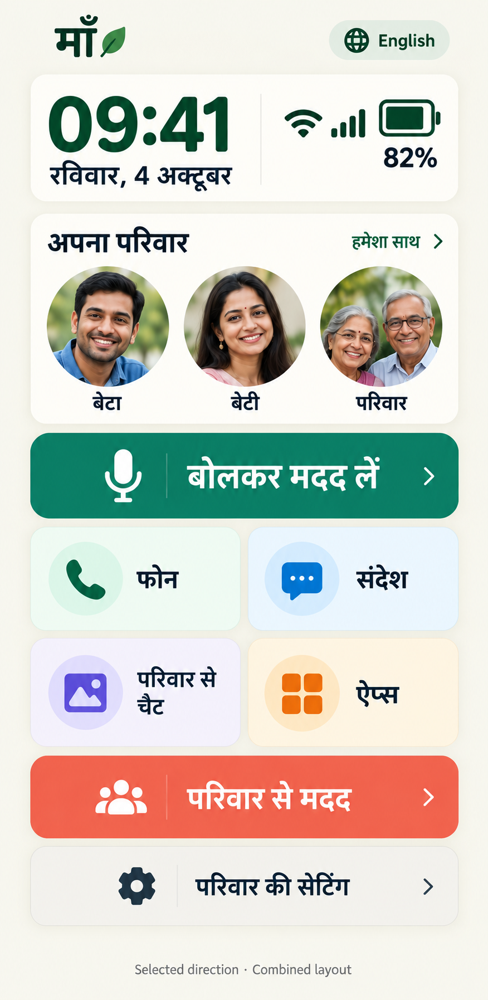

# Selected UI direction

User selection: large clock/date/battery/network panel from concept 01; family row and color-coded body from concept 02. The app implements this direction with real device values and actual configured family data. Mockup values/portraits remain fictional. Created using built-in image generation, references: 01-warm-home.png and 02-hindi-home.png.

## Exact prompt

Use case: ui-mockup. Create the FINAL COMBINED Maa launcher mockup from these two references. Reference image 1 supplies the top status card style: warm white rounded card, extra-large forest-green clock and date at left, very large battery icon and battery percentage plus large Wi-Fi/network icon and readable status at right. Enlarge battery/network indicators over reference1, keep actual UI legible. Reference image 2 supplies the ENTIRE BODY: family portrait row, big teal microphone action, 2x2 color-coded tiles with mint Phone, blue Messages, lavender Photos/family chat, amber Apps, wide coral Family help and neutral Family settings. Use warm ivory canvas from first image, no dark navy masthead. Original high contrast clean native UI. Single portrait screen, front-on, no phone hardware. App header माँ and English switch. Top illustrative time09:41, dateरविवार,4अक्टूबर, battery82%, network Wi-Fi. Preserve clean readable Devanagari like secondimage: अपना परिवार; बेटा, बेटी, परिवार; बोलकर मदद लें; फोन, संदेश, परिवार से चैट, ऐप्स; परिवार से मदद; परिवार की सेटिंग. Fictional family portraits, no tiny decorative slogans. Compact enough to resemble a real 393dp-wide Android phone screen while keeping tap targets large; bottom safe area. Caption outside screen 'Selected direction · Combined layout'. This is a concept, not actual device screenshot. Do not include WhatsApp navigation, fictitious readiness or safety claims.
